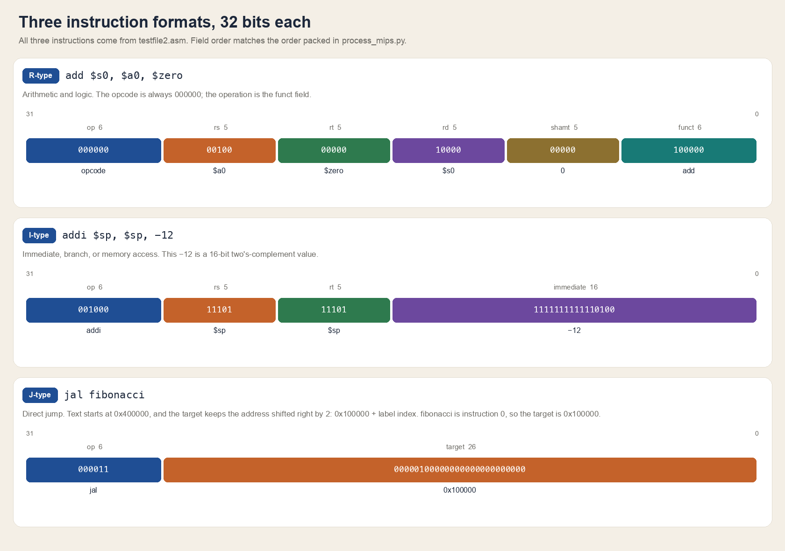
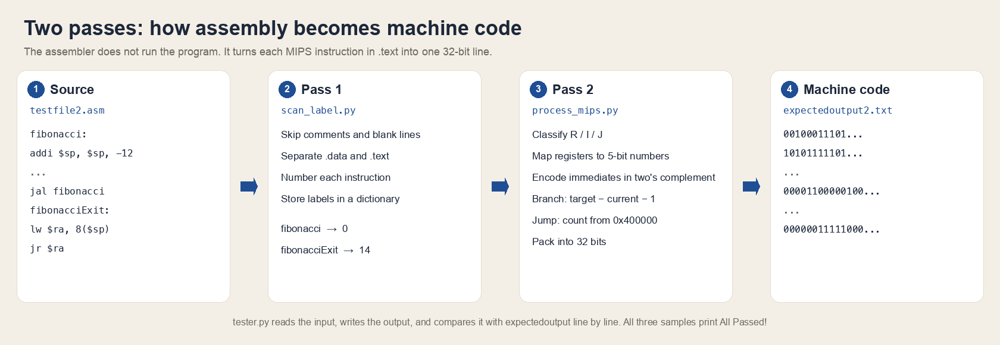

# MIPS Assembler

Course project for **CSC3050: Computer Architecture, Spring 2022** at The Chinese University of Hong Kong, Shenzhen. 

This program is a MIPS assembler. It reads a `.asm` file, translates each instruction in the `.text` segment into 32-bit binary machine code, and writes the result to a `.txt` file. It does not execute the instructions. It only performs the assembly step: assembly language to machine code.

## 1. What it models

A CPU cannot read text such as `add $t0, $t1, $t2` directly. The assembler splits each instruction into fixed fields and packs them into a 32-bit word. Basic MIPS instructions use three formats. This project does not require pseudo-instructions or coprocessor instructions.

| Type | Layout | Typical instructions |
| --- | --- | --- |
| R | `op(6) rs(5) rt(5) rd(5) shamt(5) funct(6)` | `add`, `sub`, `sll`, `jr`, `syscall` |
| I | `op(6) rs(5) rt(5) immediate(16)` | `addi`, `lw`, `sw`, `beq` |
| J | `op(6) target(26)` | `j`, `jal` |



Every R-type instruction has opcode `000000`. The specific operation is given by the 6-bit `funct` field. Register names are replaced by 5-bit numbers. For example, `$s0` = 16 = `10000`, `$s1` = 17 = `10001`, and `$s2` = 18 = `10010`.

Example from the assignment:

```text
add $s0, $s1, $s2
```

The fields are:

```text
000000 10001 10010 10000 00000 100000
```

Written as one output line:

```text
00000010001100101000000000100000
```

Here `op` is 0, `rs` is `$s1`, `rt` is `$s2`, `rd` is `$s0`, `shamt` is 0, and `funct` is 32 (`add`).

Conventions used by this assembler:

- The first instruction in `.text` is at address `0x400000`. Each following instruction is 4 bytes later.
- A label does not produce machine code. For `j` and `jal`, the low 2 bits of the label address are dropped (instruction addresses are always multiples of 4) and the remaining bits fill the 26-bit `target` field. In this program that value is `0x100000 + instruction index`.
- For branches (`beq`, `bne`, `blez`, and so on), the immediate is a word offset from the next instruction: `target index - current index - 1`. Negative values use 16-bit two's complement.
- The `.data` segment is not assembled. Static data is left for a later simulator to load into memory. This program only records each item as name, type, and contents.
- Every `syscall` encodes as `00000000000000000000000000001100`. The specific call is selected by `$v0` at execution time, so the assembler does not distinguish them.

## 2. How the program works

The assembler scans the source twice:

1. `scan_label.py` drops `#` comments and blank lines, records `.data`, and stores each `.text` label with its instruction index (starting at 0). A label may sit on its own line or on the same line as an instruction. Both forms point at the same instruction.
2. `process_mips.py` and `tester.py` scan `.text` again. After classifying each line as R, I, or J, they look up the register numbers, opcode, and funct code, pack a 32-bit string, and write one line per instruction.



| File | Role |
| --- | --- |
| `scan_label.py` | First pass: comments, `.data` records, label table |
| `process_mips.py` | Register map and R / I / J encoding |
| `tester.py` | Second pass, writes machine code, compares it with the expected file |
| `testfile.asm`, `testfile2.asm`, `testfile3.asm` | Sample inputs |
| `expectedoutput.txt`, `expectedoutput2.txt`, `expectedoutput3.txt` | Expected machine code for those inputs |

## 3. How to run

Python 3 is required. There are no third-party dependencies. From the repository root:

```bash
python3 tester.py
```

The program asks for three file names. For the Fibonacci sample in this repository:

```text
Please enter the test file name: testfile2.asm
Please enter the output file name: output2.txt
Please enter the expected output file name: expectedoutput2.txt
```

The output file is created or overwritten. If it matches the expected file line by line, the program prints:

```text
All Passed! Congratulations!
```

On a mismatch it prints the line number, the expected bits, and the actual bits. The other two samples pair `testfile.asm` with `expectedoutput.txt`, and `testfile3.asm` with `expectedoutput3.txt`.

The output is plain text: 32 `0`/`1` characters per instruction, with `\r\n` at the end of each line.

## 4. Examples

### 4.1. Loads and stores (`testfile.asm`)

The input is a series of load and store instructions. Immediates may be positive or negative, and the base register is written in parentheses:

```asm
.text
lw $t1, -400($fp)
lw $t2, 400($fp)
lw $t3, 0($fp)
sw $t1, -400($fp)
sw $t2, 400($fp)
sw $t3, 0($fp)
lwl $t1, -401($fp)
lwr $t2, 403($fp)
swl $t3, 1($fp)
swr $t3, -1($fp)
lb  $t0, -5($gp)
sb  $t0, -11560($gp)
```

`lw $t1, -400($fp)` is an I-type instruction. The opcode of `lw` is `100011`, `$fp` = 30 = `11110`, `$t1` = 9 = `01001`, and the 16-bit two's complement of `-400` is `1111111001110000`. Packed together, that is the first line of the expected output. The full result is in `expectedoutput.txt`:

```text
10001111110010011111111001110000
10001111110010100000000110010000
10001111110010110000000000000000
10101111110010011111111001110000
10101111110010100000000110010000
10101111110010110000000000000000
10001011110010011111111001101111
10011011110010100000000110010011
10101011110010110000000000000001
10111011110010111111111111111111
10000011100010001111111111111011
10100011100010001101001011011000
```

### 4.2. Labels, branches, and jumps (`testfile2.asm`)

This sample is a recursive Fibonacci routine. `fibonacci` and `fibonacciExit` are labels. `jal` jumps back to the function entry, and `jr $ra` takes the return address from a register:

```asm
.text
fibonacci:
addi $sp, $sp, -12
sw $ra, 8($sp)
sw $s0, 4($sp)
sw $s1, 0($sp)
add $s0, $a0, $zero
addi $v0, $zero, 1
slti $t7, $s0, 2
bne $t7, $zero, fibonacciExit
addi $a0, $s0, -1
jal fibonacci
add $s1, $zero, $v0
addi $a0, $s0, -2
jal fibonacci
add $v0, $s1, $v0
fibonacciExit:
lw $ra, 8($sp)
lw $s0, 4($sp)
lw $s1, 0($sp)
addi $sp, $sp, 12
jr $ra
```

`fibonacci` is instruction 0. The target of `jal fibonacci` is `0x100000 + 0`, so that line encodes as:

```text
00001100000100000000000000000000
```

`bne $t7, $zero, fibonacciExit` does not store an absolute address. It stores an offset relative to the next instruction. The full machine code is in `expectedoutput2.txt`: 19 lines, one per instruction in `.text`. The two labels do not occupy a line.

### 4.3. `.data` is skipped (`testfile3.asm`)

The file starts with static data. The assembler does not turn that data into machine code:

```asm
.data
HELLO: .ascii "hello, world\n"
LENGTH: .word 13
.text
__builtin_memcpy_aligned_large:
    addi   $t7, $a2, -4
    blez  $t7, __builtin_memcpy_bytes
    ...
```

Blank lines, full-line comments, and trailing `# ...` comments are discarded as well. A label on its own line is treated the same as a label written on the instruction line. This memcpy fragment produces 41 lines of machine code, listed in `expectedoutput3.txt`.

## 5. Supported instructions

R-type: `add` `addu` `and` `div` `divu` `jalr` `jr` `mfhi` `mflo` `mthi` `mtlo` `mult` `multu` `nor` `or` `sll` `sllv` `slt` `sltu` `sra` `srav` `srl` `srlv` `sub` `subu` `syscall` `xor`

I-type: `addi` `addiu` `andi` `beq` `bgez` `bgtz` `blez` `bltz` `bne` `lb` `lbu` `lh` `lhu` `lui` `lw` `lwl` `lwr` `ori` `sb` `sh` `slti` `sltiu` `sw` `swl` `swr` `xori`

J-type: `j` `jal`

Input may contain leading or trailing whitespace, spaces or tabs between fields, empty lines, and `#` comments. Data directives seen in `.data` include `.ascii`, `.asciiz`, and `.word`. This program records them and does not emit binary for them.

## References

- Assignment handout: CSC3050 Assignment 1 (MIPS assembler). The text segment starts at `0x400000`, and only `.text` is assembled.
- Instruction encodings: MIPS Instruction Coding (R / I / J fields, opcodes, and funct codes). Pseudo-instructions, coprocessor instructions, and `break` are not required.
